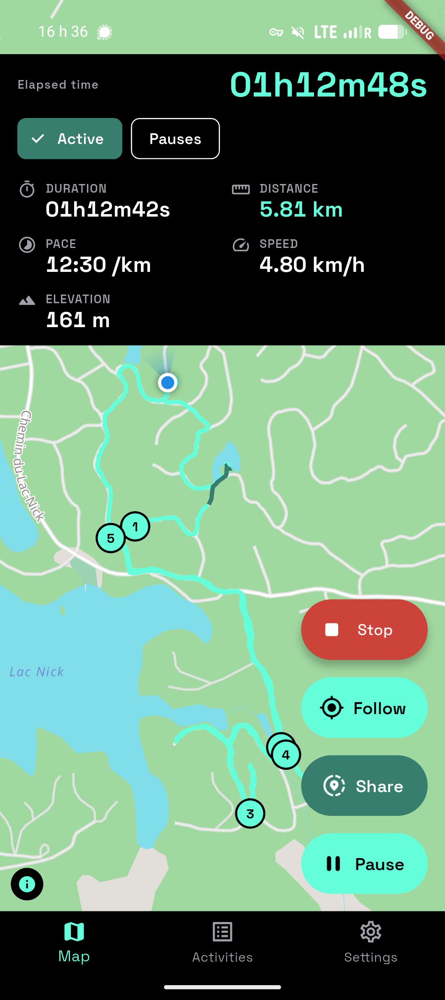
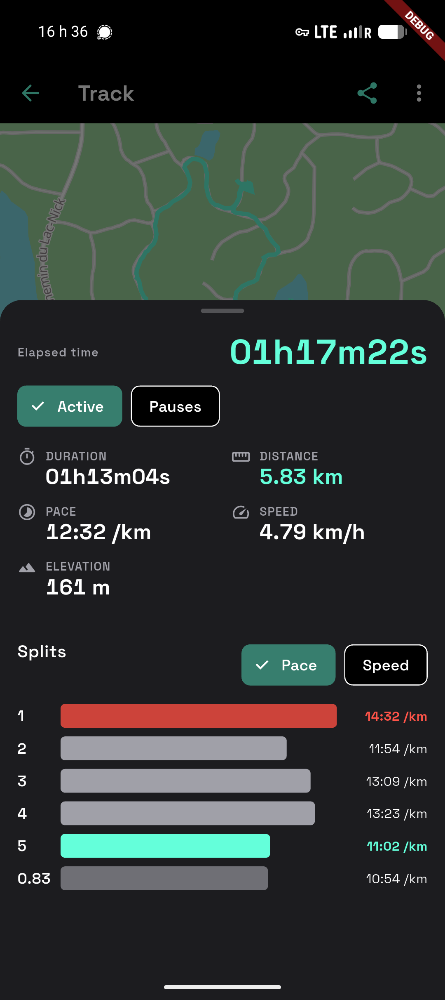
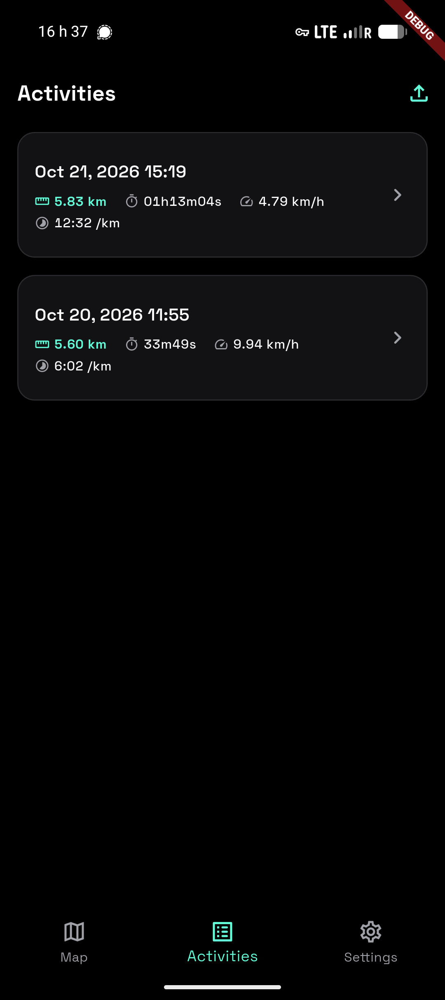
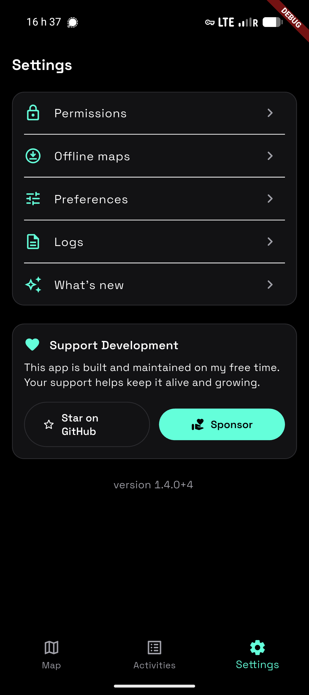
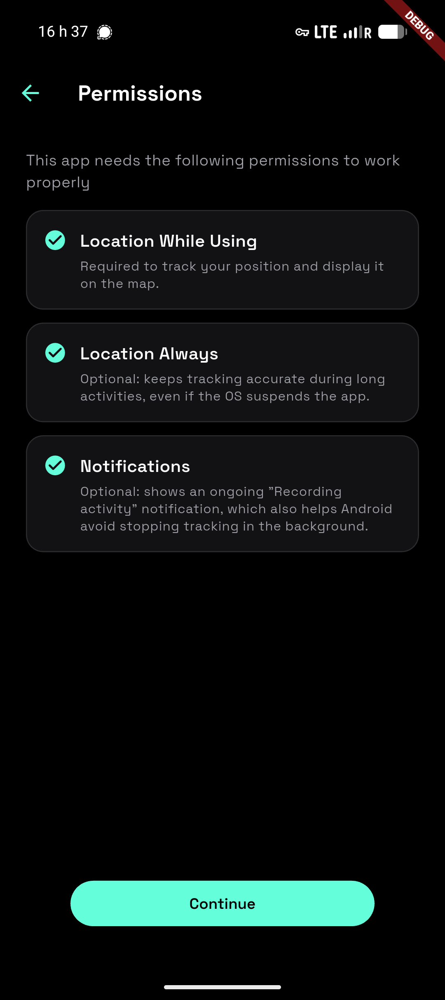
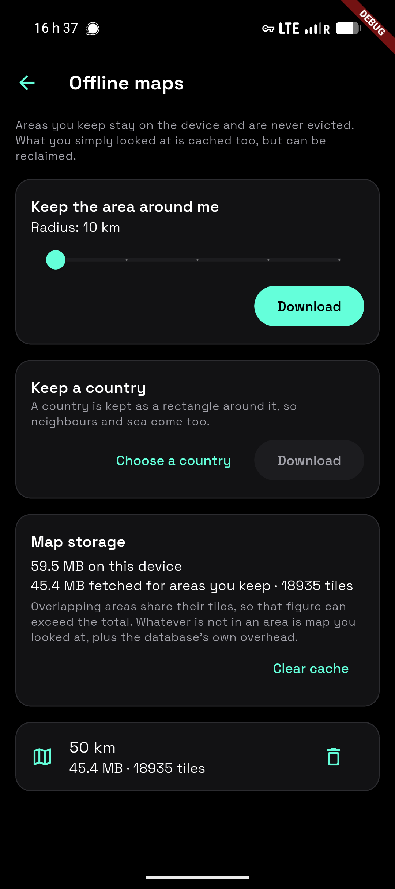
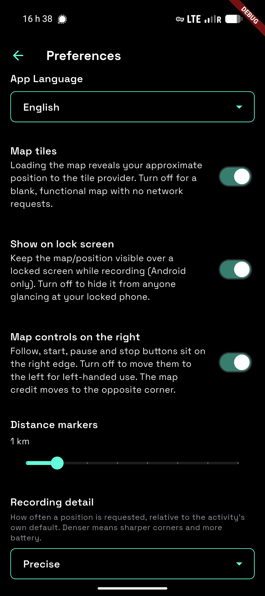
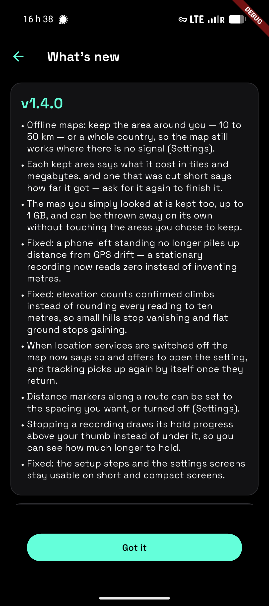

# furtive

Privacy first. No accounts. No Google services. Full access to your GPS sensor.

## Install

[Download the latest apk](https://github.com/ethicnology/furtive/releases/latest)

[](https://apps.obtainium.imranr.dev/redirect?r=obtainium://add/https://github.com/ethicnology/furtive)

The Obtainium button opens on a device with [Obtainium](https://github.com/ImranR98/Obtainium) installed. Otherwise, add it manually: paste `https://github.com/ethicnology/furtive` as a GitHub source in Obtainium.

## Screenshots

<div align="center">

<table>
<tr>
<td></td>
<td></td>
</tr>
<tr>
<td></td>
<td></td>
</tr>
<tr>
<td></td>
<td></td>
</tr>
<tr>
<td></td>
<td></td>
</tr>
</table>

</div>

## Build-time flags

- `PROTOMAPS_KEY` / `PROTOMAPS_URL` — map tiles, see "Reproducible builds"
  below.
- `SHARE_VIEWER_URL` — canonical HTTPS origin of the deployed live viewer. Live
  sharing stays hidden when this is absent, rather than minting unusable links.
- `SHARE_RELAYS` — optional comma-separated `wss://` relay list. Defaults to
  `nos.lol` and `relay.primal.net`.

## GPS signal loss

GPS stops working indoors (store, tunnel, deep urban canyon) while a
recording stays active. Furtive detects these outages from the fix cadence:
when the time since the last fix exceeds ~10× the recent median interval
(clamped to 30 s – 6 min), the gap is bracketed as a **signal lost** span —

- elapsed time is never rewritten; active duration, distance and pace
  simply exclude the outage,
- the map draws a dashed line across the unknown stretch instead of a
  solid straight line through buildings,
- the outage duration is reported on the activity detail screen,
- GPX files represent the gap as separate `<trkseg>` blocks (the GPX 1.1
  semantics for lost reception), both on export and import.

The path travelled during an outage is unknowable after the fact — for long
indoor breaks, pausing the recording manually remains the most accurate
option.

## Live tracking

Builds configured with `SHARE_VIEWER_URL` expose a live-share control while an
activity is recording. It creates an end-to-end encrypted browser link and
publishes sampled, already-accepted recording points to the configured Nostr
relays. No account or long-term Nostr key is created. An optional password is
derived with Argon2id and must be sent separately from the link.

The viewer and threat model live in [`apps/viewer/`](apps/viewer/) and
[`docs/SHARE-TRACKING.md`](docs/SHARE-TRACKING.md). A full process kill ends a
share because its ephemeral keys are deliberately never persisted; recording
resume remains independent.

## Development

The repository is a Dart pub workspace: `apps/app` is the Flutter
application, `apps/viewer` the static web viewer, and `packages/furtive_share`
the pure-Dart wire format and cryptography both of them share. One lockfile
resolves all three, and each declares what it may depend on in its
`module.yaml`.

Melos runs every task, defined in the `melos:` section of the root
`pubspec.yaml`. The scripts call `flutter` and `dart` from the PATH, so they
are identical in CI, which installs Flutter directly, and locally, where
`fvm exec` puts the version pinned in `.fvmrc` on the PATH:

```sh
fvm install                                  # once, installs the pinned SDK
fvm exec dart pub get --enforce-lockfile
fvm exec dart run melos bootstrap
fvm exec dart run melos run verify
```

`verify` is exactly what CI runs: generation, ARB key parity across every
locale, module boundaries, the dependency graph, formatting, analysis with
`--fatal-infos`, the share-layer boundary, every member's tests with
coverage, the coverage floor, and both viewer packagings.
`fvm exec dart run melos run --list` shows the individual scripts; the
useful ones during development are `generate`, `analyze`, `test`,
`architecture` and `app`.

Generated sources — ARB output and drift code — are not committed. Run
`melos run generate` in a fresh clone, modify the generator inputs rather
than their output, and never edit a generated file.

The container build, the release artefacts and the dev container are Melos
scripts too: `apk`, `reproducible`, `devcontainer:create` and
`devcontainer:start`.

## Releases

Release artifacts are produced unsigned by Flutter (`signingConfig = null`
in `apps/app/android/app/build.gradle.kts`) and signed out-of-band with
`apksigner` / `zipalign`. Keystores never enter this repository — do
not add a `key.properties` or wire signing into Gradle.

## Reproducible builds

`fvm exec dart run melos run reproducible` verifies that two clean APK builds in the same pinned
container produce byte-identical output. The repository pins the major inputs:

- `debian:trixie@sha256:…` (multi-arch index digest, in `Containerfile.tools`)
- Flutter `3.47.6` via `.fvmrc`
- Android NDK / SDK / build-tools / JVM in `apps/app/android/gradle.properties`
- `pubspec.lock` enforced via `flutter pub get --enforce-lockfile`
- Gradle distribution, FVM installer, and Android command-line tools checksums
- `SOURCE_DATE_EPOCH = $(git log -1 --format=%ct)` passed to the container
  so Gradle/AGP/Kotlin emit deterministic timestamps

Verify locally with `fvm exec dart run melos run reproducible` (builds twice, compares
SHA-256, fails with a diffoscope hint on mismatch).

This is not a timeless guarantee across arbitrary future package mirrors:
Debian and Android SDK repositories can replace the versions selected by their
package managers. Release hashes remain the authority, and a third-party
verification should use the release's documented container image and inputs.

Empty/missing `PROTOMAPS_KEY` produces the FOSS path (no map tiles, but
otherwise functional) — that's the variant anyone in the world can
rebuild and verify bit-for-bit. The keyed variant is reproducible by
anyone holding the same key. Mobile API keys are not secret in any
case: anyone can extract one from a shipped APK via `strings`.
